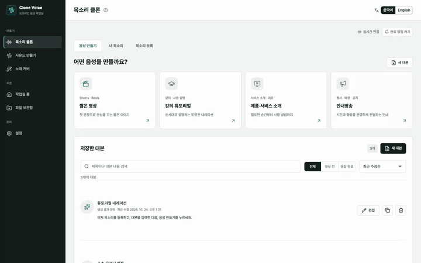

<div align="center">

# Clone Voice Studio

**내 컴퓨터에서, 인터넷 없이.**<br>
목소리 클론 · 다국어 음성 · 효과음 · 노래 커버를 한곳에서 만드는 오프라인 AI 음성 스튜디오

[English](README.en.md) · 한국어

[](LICENSE)




[나레이션 포함 전체 영상 (MP4)](docs/media/clone-voice-demo-narrated.mp4)

</div>

Clone Voice Studio는 **공개 AI 모델을 내려받아 활용하는 오프라인 제작 도구**입니다. 이 저장소에는 모델이 들어 있지 않습니다. 설치할 때 각 모델의 공식 배포처에서 내려받고, 한 번 받은 뒤에는 인터넷 없이 내 컴퓨터에서 실행합니다. 대본, 목소리 샘플, 생성 결과는 모두 내 컴퓨터에만 저장됩니다.

> **모델은 각 모델의 라이선스를 따릅니다.** 이 저장소의 코드는 MIT이지만, 내려받아 쓰는 모델·가중치에는 적용되지 않습니다. 상업적 이용이나 재배포 전에 [사용하는 모델과 라이선스](#사용하는-모델과-라이선스)를 확인하세요.

## 할 수 있는 일

| | |
| --- | --- |
| 🎙 **목소리 클론** | 5~10초 샘플로 내 목소리를 등록하고, 한국어·영어 등 여러 언어의 음성을 만듭니다. |
| ▶️ **YouTube·Instagram에서 가져오기** | 링크를 붙여 넣고 필요한 구간만 가져와 목소리를 등록합니다. 긴 영상도 구간만 받으므로 빠릅니다. |
| 🎵 **노래 커버** | 노래의 보컬을 분리해 등록한 목소리로 바꾸고 반주와 다시 합칩니다. |
| 🔊 **효과음** | 장면 설명으로 효과음을 만들고, 프로젝트별로 버전을 관리합니다. |
| 💬 **대화 오디오** | 자료나 주제로 2~4명의 대화를 만들고 화자별 목소리로 완성합니다. |
| 📝 **받아쓰기·번역** | 음성을 글로 바꾸고 원하는 언어로 번역합니다. Mac에서는 Apple 온디바이스 기능을 씁니다. |

## 설치

터미널에 한 줄이면 됩니다. 필요한 도구(uv, Python, Node.js, pnpm, ffmpeg)와 모델까지 알아서 설치합니다.

```bash
curl -fsSL https://raw.githubusercontent.com/dev-restart/clone-voice/main/install.sh | bash
```

이미 저장소를 받았다면 저장소 안에서 실행합니다.

```bash
./install.sh            # 설치할 모델을 고르며 진행
./install.sh --yes      # 권장 설정(음성 + 받아쓰기)으로 바로 진행
./install.sh --models all
```

설치가 끝나면 실행합니다.

```bash
./start.sh              # http://127.0.0.1:18185
```

저장소를 받자마자 `./start.sh`만 실행해도 됩니다. 실행에 필요한 준비를 알아서 합니다.

- **필요한 도구와 의존성 자동 준비**: uv, Node.js, pnpm, ffmpeg가 없으면 `./install.sh`를 먼저 실행하고, 의존성과 `backend/.env`도 만들어 줍니다.
- **필요한 모델 자동 설치**: 음성 모델(VoxCPM2)이나 받아쓰기 모델(Whisper)이 없으면 처음 한 번 이 프로젝트의 `backend/models/`에 내려받고 시작합니다. `CLONE_VOICE_VOXCPM_CACHE_DIR`로 지정했거나 전역 캐시(`~/.cache`)에 이미 받아 둔 모델은 다시 받지 않고 그대로 씁니다. 폴더를 지우면 모델도 함께 지워집니다.
- **노래 커버·효과음 모델도 자동 설치(Apple Silicon)**: SoulX-Singer와 Stable Audio 3는 Apple Silicon Mac에서만 받습니다. 다른 환경에서는 건너뜁니다. 전체 약 10GB 이상이 필요해서 음성·받아쓰기 모델만 받으려면 `./start.sh --core-models`를 쓰세요.
- **잘 쓰지 않는 포트**: 다른 개발 서버와 겹치지 않도록 화면은 `18185`, 서버는 `18109`를 씁니다.
- **포트가 사용 중이면 종료하고 실행**: 이전 실행이 남아 있거나 다른 프로그램이 같은 포트를 잡고 있으면 그 프로세스를 종료하고(종료한 PID와 이름을 출력합니다) 시작합니다.

```bash
./start.sh --core-models                  # 음성·받아쓰기 모델만 받음
./start.sh --no-models                    # 모델을 자동으로 받지 않음
./start.sh --no-kill                      # 포트가 사용 중이면 종료하지 않고 멈춤
FRONTEND_PORT=19000 BACKEND_PORT=19001 PUBLIC_API_BASE=http://127.0.0.1:19001 ./start.sh
```

> **지원 환경** macOS(Apple Silicon 권장), Linux, Windows는 WSL 2. Linux·WSL 2에서는 하드웨어에 따라 생성 속도가 달라지고, 노래 커버와 효과음 모델은 현재 Apple Silicon 전용입니다. 모델마다 수 GB의 디스크가 필요합니다.

## 모델을 골라 쓰는 구조

앱은 모델을 **영역**별로 나눠 관리합니다. 설정 → 모델에서 영역마다 기본 모델을 정하면, 각 작업 화면의 모델 선택에도 그대로 나타납니다.

| 영역 | 쓰이는 곳 | 포함된 모델 |
| --- | --- | --- |
| 음성 | 목소리 클론, 대화 오디오 | [VoxCPM2](https://github.com/OpenBMB/VoxCPM) |
| 음악 | (모델 추가 대기) | — |
| 커버 | 노래 커버 | [SoulX-Singer](https://github.com/Soul-AILab/SoulX-Singer) |
| 효과음 | 사운드 만들기 | [Stable Audio 3 Small-SFX](https://github.com/Stability-AI/stable-audio-3) |
| 받아쓰기 | 목소리 등록, 받아쓰기 | [Whisper](https://github.com/openai/whisper) · Apple Speech(Mac) |

새 모델은 어댑터 하나를 작성해 등록하면 해당 영역에 나타납니다. 방법은 [모델 추가하기](docs/adding-a-model.md)를 보세요.

## 텍스트 AI는 선택입니다

목소리 클론과 음성 생성에는 텍스트 AI(LLM)가 필요하지 않습니다. 대본 작성, 번역, 대화 초안 같은 보조 기능에서만 쓰며, 설정 → AI 연결에서 고릅니다.

- **로컬**: Ollama, LM Studio 등 내 컴퓨터의 서버
- **Mac 내장**: Apple 온디바이스 번역
- **외부 API**: DeepSeek, OpenRouter, Gemini, Claude, OpenAI 등 (직접 등록할 때만 사용, 기본은 '로컬 전용')

## 한국어 · English

화면 오른쪽 위에서 표시 언어를 바꿀 수 있습니다. 대본·음성의 언어와는 별개입니다.

## 문서

- [사용 가이드](docs/user-guide.md) · [User guide (English)](docs/user-guide.en.md)
- [모델 추가하기](docs/adding-a-model.md)
- [구조](docs/architecture.md) · [기여하기](CONTRIBUTING.md) · [보안](SECURITY.md)
- 디자인 시스템: `cd frontend && pnpm storybook`

## 책임 있는 사용

이 앱은 믿을 수 있는 한 사람이 자기 컴퓨터에서 쓰는 도구입니다. 인증과 사용자 분리가 없으므로 인터넷에 그대로 공개하지 마세요. 타인의 목소리나 노래를 쓸 때는 당사자의 동의와 사용 권한을 확인하고, 생성물을 실제 발언으로 오인시키지 마세요. YouTube·Instagram 가져오기는 본인 콘텐츠이거나 가공 권한이 있는 자료에만 쓰고 각 서비스의 약관을 확인하세요.

## 사용하는 모델과 라이선스

Clone Voice Studio는 아래 모델을 **직접 포함하거나 재배포하지 않고**, 설치 스크립트로 각 공식 배포처에서 내려받아 사용하는 도구입니다. 모델을 쓰는 사람이 해당 모델의 라이선스와 이용 조건을 따라야 합니다.

| 모델 | 용도 | 라이선스(요약) | 공식 배포처 |
| --- | --- | --- | --- |
| VoxCPM2 | 목소리 클론·음성 생성 | Apache-2.0 | [OpenBMB/VoxCPM](https://github.com/OpenBMB/VoxCPM) |
| Whisper | 받아쓰기 | MIT | [openai/whisper](https://github.com/openai/whisper) |
| SoulX-Singer | 노래 커버 | Apache-2.0 (변환 가중치는 각 배포물 확인) | [Soul-AILab/SoulX-Singer](https://github.com/Soul-AILab/SoulX-Singer) |
| Stable Audio 3 Small-SFX | 효과음 | 가중치: Stability AI Community License | [Stability-AI/stable-audio-3](https://github.com/Stability-AI/stable-audio-3) |

- 위 표는 요약이며 정확한 조건은 각 모델의 라이선스 원문과 모델 카드가 기준입니다. 모델이 업데이트되면 조건이 바뀔 수 있습니다.
- 모델이 만든 결과물의 이용 범위(상업적 이용, 출처 표기, 매출 규모에 따른 제한 등)도 모델의 라이선스를 따릅니다. 특히 Stable Audio 3 가중치는 별도의 커뮤니티 라이선스 조건이 있습니다.
- 사용자가 추가로 연결하는 텍스트 AI(Ollama, LM Studio, 외부 API 등)도 각 제공처의 약관을 따릅니다.
- 더 자세한 구성요소별 구분은 [THIRD_PARTY_NOTICES.md](THIRD_PARTY_NOTICES.md)에 있습니다.

## 라이선스

이 저장소의 **코드와 문서**는 [MIT License](LICENSE)입니다. 모델 가중치, 외부 런타임(yt-dlp, FFmpeg 등), 가져온 영상·음원에는 이 라이선스가 적용되지 않으며 각자의 라이선스와 권리자의 허락을 따릅니다.
